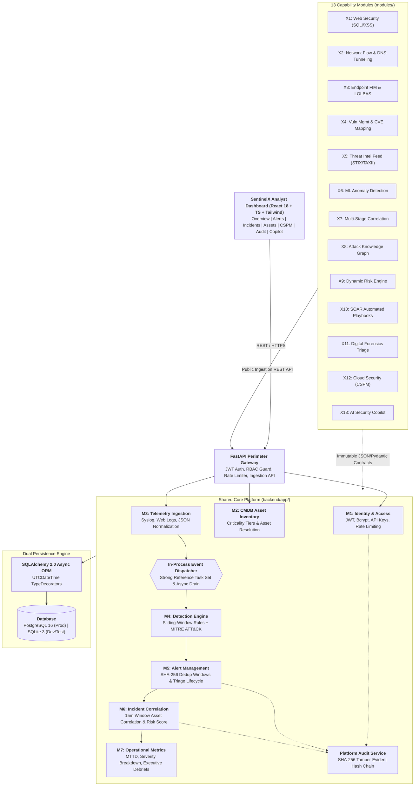

# 🛡️ SentinelX: Autonomous AI-Powered Modular Cybersecurity Operations Platform

[](LICENSE)
[](https://python.org)
[](https://fastapi.tiangolo.com)
[](https://react.dev)
[](https://www.typescriptlang.org)
[](https://tailwindcss.com)
[](https://www.postgresql.org)
[](https://sqlite.org)
[](docs/ARCHITECTURE.md)

**SentinelX** is an enterprise-grade, modular cybersecurity operations platform engineered around the complete modern threat management lifecycle:

$$\text{Collect} \longrightarrow \text{Detect} \longrightarrow \text{Correlate} \longrightarrow \text{Investigate} \longrightarrow \text{Prioritize} \longrightarrow \text{Respond} \longrightarrow \text{Report}$$

Engineered with strict architectural boundaries, SentinelX integrates a high-throughput **Shared Core Platform (M1–M7)** with **13 pluggable Capability Modules (X1–X13)** spanning threat intelligence, machine learning anomaly detection, attack path knowledge graphs, SOAR playbooks, digital forensics, cloud security posture management (CSPM), and an AI security copilot.

---

## 📑 Table of Contents

- [Architectural Overview](#-architectural-overview)
- [System Capabilities & Module Matrix](#-system-capabilities--module-matrix)
- [Analyst Dashboard & UI Features](#-analyst-dashboard--ui-features)
- [Quickstart Guide (Local Development)](#-quickstart-guide-local-development)
- [Default User Personas & Credentials](#-default-user-personas--credentials)
- [Running with Docker Compose](#-running-with-docker-compose-production-setup)
- [Attack Simulators & Demo Scenarios](#-attack-simulators--demo-scenarios)
- [Verification & Automated Testing](#-verification--automated-testing)
- [Cryptographic Audit Verification](#-cryptographic-audit-verification)
- [Repository Structure](#-repository-structure)
- [Core Architectural Laws](#-core-architectural-laws)
- [License](#-license)

---

## 🏛️ Architectural Overview



---

## 🧩 System Capabilities & Module Matrix

SentinelX is divided into **7 Core Platform Modules** and **13 Pluggable Capability Modules**:

### Core Platform Modules (M1–M7)
| ID | Module Name | Implementation | Functionality |
|:---|:---|:---|:---|
| **M1** | Identity & Access Management | `backend/app/services/auth_service.py` | Role-Based Access Control (`Admin`, `Analyst`, `Auditor`), Bcrypt password hashing, PyJWT tokens, and brute-force rate limiting. |
| **M2** | CMDB Asset Management | `backend/app/services/asset_service.py` | Asset inventory, criticality tiers (`critical`, `high`, `medium`, `low`), and 3-tier target resolution (`asset_id` $\to$ `hostname` $\to$ `ip`). |
| **M3** | Security Event Ingestion | `backend/app/services/ingestion_service.py` | REST Ingestion API (`POST /api/v1/events/ingest`), API key asset binding precedence, JSON/Syslog/Web normalizers, post-commit dispatcher. |
| **M4** | Sliding-Window Detection | `backend/app/services/detection_service.py` | Declarative YAML detection rules with MITRE ATT&CK mapping (`T1110`, `T1046`, `T1190`, `T1071`) evaluating temporal sliding windows. |
| **M5** | Alert Management & Triage | `backend/app/services/alert_service.py` | Deterministic SHA-256 deduplication windows, concurrent row-locking (`with_for_update`), evidence aggregation, state machine (`NEW` $\to$ `INVESTIGATING` $\to$ `RESOLVED`). |
| **M6** | Incident Correlation | `backend/app/services/incident_service.py` | Multi-alert correlation within 15-minute asset windows, closed-form bounded risk scoring ($[0, 100]$), timeline reconstruction, and notification webhooks. |
| **M7** | Reporting & Metrics | `backend/app/services/report_service.py` | Live SOC operational KPIs (MTTD latency, active alerts, severity distribution) and automated executive debrief reports in Markdown/HTML. |

### Pluggable Capability Modules (X1–X13)
| ID | Module Name | Directory | Primary Capabilities |
|:---|:---|:---|:---|
| **X1** | **Web Security Analyzer** | `modules/web_security/` | Web access log scanner, SQL injection (`T1190`, CWE-89) and XSS detection, standalone CLI runner and REST forwarding. |
| **X2** | **Network Security Analyzer** | `modules/network_security/` | TCP/UDP port reconnaissance scan detector (`T1046`), DNS tunneling analysis with Shannon entropy calculation (`T1071.004`). |
| **X3** | **Endpoint Security Monitor** | `modules/endpoint_security/` | File Integrity Monitoring (FIM / `T1565.001`), LOLBAS process creation heuristics, host tampering detection. |
| **X4** | **Vulnerability Management** | `modules/vulnerability_management/` | Asset exposure mapping, CVE database matching, CVSS v3 scoring, and CISA Known Exploited Vulnerabilities (KEV) prioritization. |
| **X5** | **Threat Intelligence Feeds** | `modules/threat_intelligence/` | STIX/TAXII threat feed consumption, malicious IP/domain/hash reputation matching, and automated IOC enrichment. |
| **X6** | **ML Anomaly Detection** | `modules/ml_detection/` | Unsupervised behavioral baseline analytics, Isolation Forest anomaly scoring, and temporal outlier identification. |
| **X7** | **Advanced Correlation** | `modules/correlation/` | Multi-stage kill-chain reconstruction (Recon $\to$ Initial Access $\to$ Persistence $\to$ Exfiltration) and cross-asset lateral movement tracking. |
| **X8** | **Knowledge Graph Engine** | `modules/knowledge_graph/` | In-memory directed multigraph, Dijkstra shortest attack path discovery to Crown Jewels, and transitive BFS blast-radius calculation. |
| **X9** | **Dynamic Risk Engine** | `modules/risk_engine/` | Multi-factor quantitative risk scoring incorporating asset criticality multipliers, threat velocity, CISA KEV status, and topological reachability. |
| **X10** | **SOAR Playbook Engine** | `modules/soar/` | Automated containment execution (`block_ip`, `isolate_host`, `disable_user`) with analyst approval gates and reversible rollback actions. |
| **X11** | **Digital Forensics Triage** | `modules/forensics/` | Automated volatile artifact triage, memory and disk artifact preservation, and Merkle Root SHA-256 cryptographic package sealing. |
| **X12** | **Cloud Security (CSPM)** | `modules/cloud_security/` | Multi-cloud control plane posture auditing (AWS S3, Azure Blob, GCP Storage, IAM policies) against CIS benchmarks. |
| **X13** | **AI Security Copilot** | `modules/ai_assistant/` | Natural language incident briefing, contextual remediation advice, query synthesis, and automated MITRE ATT&CK mapping. |

---

## 🖥️ Analyst Dashboard & UI Features

The frontend is a dark-mode, responsive SPA built with **React 18**, **TypeScript**, and **Tailwind CSS**:

1. **Executive SOC Dashboard**: Real-time KPI summary (MTTD, open incidents, triggered alerts, monitored assets) and severity breakdown charts.
2. **Alerts Queue & Evidence Drawer**: Paginated alert triage with 1-click status transitions (`INVESTIGATING`, `RESOLVED`, `FALSE_POSITIVE`) and detailed raw JSON evidence inspection.
3. **Incidents Management & Live Timeline**: Incident correlation tracking, bounded $[0, 100]$ risk score visualization, and full chronological incident event playback.
4. **Interactive Attack Simulation**: Built-in modal in the top navigation bar to trigger 7 live attack scenarios with real-time UI toast notifications.
5. **Interactive Attack Topology Graph**: Visual graph of monitored hosts, Crown Jewels, active threats, and transitive blast radius reachability.
6. **SOAR Playbook Execution**: Analyst-approved automated containment actions (Firewall IP blocks, host quarantine, account lockout) with audit logging.
7. **Cloud Security (CSPM)**: Compliance scorecards, cloud finding triage, and resource misconfiguration auditing.
8. **AI Security Copilot**: Contextual incident briefing assistant offering instant investigation guidance and containment playbooks.
9. **Cryptographic Audit Log Viewer**: Verifiable hash chain explorer with 1-click cryptographic integrity verification.

---

## 🚀 Quickstart Guide (Local Development)

### Prerequisites
* **Python 3.13+** (AMD64 / x86_64)
* **Node.js v20+** and **npm v10+**

### Step-by-Step Installation

#### 1. Clone the Repository & Configure Environment
```bash
git clone https://github.com/paranoid109/sen.git
cd sen
cp .env.example .env
```

#### 2. Set Up Python Virtual Environment
```bash
# Create virtual environment
python -m venv .venv

# Activate on Windows:
.venv\Scripts\activate

# Activate on Linux/macOS:
source .venv/bin/activate
```

#### 3. Install Backend Dependencies
```bash
pip install -r backend/requirements.txt
```

#### 4. Initialize & Seed the Database (SQLite local dev)
```bash
python scripts/seed_db.py
```
*Creates initial CMDB assets, default ingestion API keys, and seeded user personas while maintaining cryptographic hash chain continuity.*

#### 5. Start the FastAPI Backend Server
```bash
python -m uvicorn backend.app.main:app --reload --host 127.0.0.1 --port 8000
```
* **Swagger Interactive Docs**: `http://localhost:8000/docs`
* **ReDoc API Reference**: `http://localhost:8000/redoc`
* **Health Check**: `http://localhost:8000/health`

#### 6. Start the React Frontend Dashboard
Open a second terminal:
```bash
cd frontend
npm install
npm run dev
```
Open **`http://localhost:5173`** in your browser.

---

## 🔑 Default User Personas & Credentials

The login screen (`http://localhost:5173/login`) provides 1-click persona quickfill buttons:

| Persona | Username | Password | Role & Permissions |
|:---|:---|:---|:---|
| **Admin** | `admin` | `Admin123!Secure` | Full administrative control, CMDB asset management, API key issuance, Cryptographic Audit Verification. |
| **Analyst** | `analyst` | `Analyst123!Secure` | Alert triage, incident response, SOAR containment execution, Forensics triage, AI Copilot, report generation. |
| **Auditor** | `auditor` | `Auditor123!Secure` | Read-only compliance access across all SOC telemetry, alerts, incidents, and audit trails. |

---

## 🐳 Running with Docker Compose (Production Setup)

Run the full platform stack (PostgreSQL 16, FastAPI backend, and Nginx-backed React frontend) with a single command:

```bash
docker compose up -d --build
```

### Deployed Services
| Service | URL | Description |
|:---|:---|:---|
| **Frontend UI** | `http://localhost:5173` | React analyst dashboard served via Nginx |
| **Backend API** | `http://localhost:8000` | FastAPI core platform and REST ingestion gateway |
| **Interactive API Docs**| `http://localhost:8000/docs` | Swagger UI with OpenAPI 3.1 documentation |
| **PostgreSQL DB** | `localhost:5432` | PostgreSQL 16 relational store with persistent volume |

To tear down the environment:
```bash
docker compose down -v
```

---

## 🎯 Attack Simulators & Demo Scenarios

SentinelX includes a complete suite of realistic attack simulators mapped to MITRE ATT&CK techniques:

### In-App 1-Click Simulation (Recommended)
1. Log into the dashboard (`http://localhost:5173`) as `Analyst` or `Admin`.
2. Click the **Simulate Attack** button in the top navigation bar.
3. Select any scenario:
   * **SSH Brute Force** (`T1110.001` - Credential stuffing against `server-prod-01`)
   * **TCP Port Reconnaissance** (`T1046` - Port scan sweep against `db-prod-01`)
   * **SQL Injection Exploitation** (`T1190` - Web application attack against `web-prod-01`)
   * **Ransomware / Host Tampering** (`T1565.001` - File integrity tampering and privilege escalation)
   * **DNS Data Exfiltration** (`T1071.004` - High-entropy encoded DNS tunneling)
   * **Cloud Misconfiguration** (`T1530` - Unauthenticated AWS S3 and Azure Blob exposures)
   * **Full Multi-Stage Kill Chain** (Recon $\to$ Exploit $\to$ Tamper $\to$ Exfiltration)
4. Click **Launch Attack Simulation** and watch real-time alerts, incidents, and risk escalations populate the UI.

### Command-Line Attack Simulators
```bash
# 1. SSH Brute Force Simulation (T1110.001)
python scripts/simulate_bruteforce.py --attempts 6

# 2. TCP Port Reconnaissance Scan (T1046)
python scripts/simulate_portscan.py

# 3. SQL Injection Web Attack (T1190)
python scripts/simulate_sqli.py

# 4. DNS Tunneling Exfiltration (T1071.004)
python scripts/simulate_dns_tunneling.py

# 5. Endpoint File Tampering / FIM (T1565.001)
python scripts/simulate_endpoint_tamper.py

# 6. Multi-Stage Kill Chain Campaign
python scripts/simulate_campaign.py --stage all
```

---

## 🧪 Verification & Automated Testing

SentinelX includes an extensive automated verification and test suite:

### 1. End-to-End Automated Platform Verification
Run the single-command comprehensive verification script to test all 6 platform tiers and advanced capabilities:
```bash
python scripts/verify_e2e_platform.py
```
*Validates system health, multi-role RBAC enforcement, CMDB resolution, detection pipelines, MTTD metrics, SOAR execution, forensics packages, and SHA-256 cryptographic audit integrity.*

### 2. Unit & Integration Test Suites
```bash
# Run all unit tests across M1-M7 and X1-X13 (28 test suites)
pytest tests/unit/ -v

# Run the end-to-end SOC pipeline integration test
pytest tests/integration/test_soc_pipeline.py -v

# Run with test coverage
pytest --cov=backend/app --cov=modules tests/
```

### 3. Capability Module Standalone Self-Tests
All capability modules can be tested independently without running the full platform:
```bash
python -m modules.web_security.standalone --test
python -m modules.network_security.standalone --test
python -m modules.endpoint_security.standalone --test
python -m modules.soar.standalone --test
python -m modules.forensics.standalone --test
python -m modules.cloud_security.standalone --test
python -m modules.ai_assistant.standalone --test
```

### 4. Offline Benchmark Evaluation
Run the offline academic benchmark evaluating detection accuracy, precision, recall, and F1-score against labelled datasets:
```bash
python scripts/evaluate.py
```

---

## 🔒 Cryptographic Audit Verification

SentinelX enforces **Law 4: Tamper-Evident Hash Chaining**. Every security mutation (authentication events, asset modifications, alert triage, incident updates) is linked via SHA-256 hash chaining:

$$\text{Hash}_n = \text{SHA-256}\left(\text{Hash}_{n-1} \,\|\, \text{Sequence}_n \,\|\, \text{Timestamp}_n \,\|\, \text{Action}_n \,\|\, \text{Actor}_n \,\|\, \text{DetailsHash}_n\right)$$

### Verifying Chain Integrity
* **Via Web Dashboard**: Navigate to **Admin Audit** (`/admin/audit`) and click **Verify Chain Integrity**. A green badge confirms chain continuity; any altered record flags an immediate tampering alert.
* **Via REST API**:
  ```bash
  curl -X GET http://localhost:8000/api/v1/audit/verify \
    -H "Authorization: Bearer <ADMIN_JWT_TOKEN>"
  ```
  Returns `{"is_valid": true, "total_records": N, "verified_at": "..."}`.

---

## 📁 Repository Structure

```
sen/
├── backend/
│   ├── alembic/                # Database migrations & revision scripts
│   ├── app/
│   │   ├── api/v1/             # REST route endpoints (auth, assets, events, alerts, incidents, reports, audit)
│   │   ├── core/               # Configuration, security utilities, database session, in-process dispatcher
│   │   ├── models/             # SQLAlchemy 2.0 ORM declarative models
│   │   ├── rules/              # Declarative YAML detection rules with MITRE ATT&CK IDs
│   │   ├── schemas/            # Pydantic v2 validation and response models
│   │   ├── services/           # Domain business logic (M1–M7 implementations)
│   │   └── main.py             # FastAPI perimeter application entrypoint
│   ├── Dockerfile              # Production backend container build
│   └── requirements.txt        # Pinned Python production dependencies
├── contracts/
│   ├── actions/                # SOAR containment Action Contract schema
│   ├── alerts/                 # Detection Alert Contract schema
│   ├── events/                 # Normalized Event Contract schema
│   ├── findings/               # Pluggable Finding Contract schema
│   ├── incidents/              # Correlated Incident Contract schema
│   └── python/models.py        # Pydantic v2 contractual models for all schemas
├── frontend/
│   ├── src/
│   │   ├── components/         # Modals, Topbar, Sidebar, TopologyGraph, EvidenceDrawer, Copilot
│   │   ├── context/            # Authentication & Toast notification contexts
│   │   ├── pages/              # Dashboard, Alerts, Incidents, Assets, CloudSecurity, AdminAudit, Login
│   │   ├── services/           # Axios REST API client
│   │   └── types/              # TypeScript interface twins matching Python contracts
│   ├── Dockerfile              # Multi-stage production Nginx frontend container
│   └── package.json            # Node.js dependencies (React 18, Vite, Lucide, Tailwind)
├── modules/                    # Pluggable capability modules (X1–X13)
│   ├── ai_assistant/           # X13: GenAI SOC Copilot & briefing engine
│   ├── cloud_security/         # X12: Cloud Security Posture Management (CSPM)
│   ├── correlation/            # X7: Multi-stage kill-chain correlation
│   ├── endpoint_security/      # X3: File Integrity Monitoring (FIM) & LOLBAS
│   ├── forensics/              # X11: Digital forensics collector & Merkle package sealer
│   ├── knowledge_graph/        # X8: Directed attack path graph & shortest path solver
│   ├── ml_detection/           # X6: Isolation Forest unsupervised anomaly detection
│   ├── network_security/       # X2: Port scan heuristics & Shannon DNS tunneling
│   ├── risk_engine/            # X9: Dynamic multi-factor risk quantification
│   ├── soar/                   # X10: Automated containment playbooks & reversible rollbacks
│   ├── threat_intelligence/    # X5: STIX/TAXII feed parsing & IOC reputation matcher
│   ├── vulnerability_management/# X4: CVE exposure scoring & CISA KEV prioritization
│   └── web_security/           # X1: Web log SQLi & XSS pattern analyzer
├── scripts/
│   ├── evaluate.py             # Academic evaluation benchmark runner
│   ├── seed_db.py              # Initial CMDB assets, users, and API key seeder
│   ├── simulate_bruteforce.py  # SSH brute force attack simulator (T1110.001)
│   ├── simulate_campaign.py    # Multi-stage kill-chain campaign simulator
│   ├── simulate_dns_tunneling.py# DNS tunneling data exfiltration simulator (T1071.004)
│   ├── simulate_endpoint_tamper.py # Host tampering & FIM simulator (T1565.001)
│   ├── simulate_portscan.py    # TCP port reconnaissance simulator (T1046)
│   ├── simulate_sqli.py        # Web application SQL injection simulator (T1190)
│   └── verify_e2e_platform.py  # End-to-end platform automated verification suite
├── tests/
│   ├── fixtures/               # Evaluation datasets & test packet traces
│   ├── integration/            # End-to-end pipeline integration tests
│   └── unit/                   # 28 isolated unit test suites (M1–M7 and X1–X13)
├── docs/                       # Architectural specifications, ADRs, Threat Model, Charter
├── .github/workflows/ci.yml    # Automated GitHub Actions CI pipeline
└── docker-compose.yml          # Production multi-container orchestration
```

---

## ⚖️ Core Architectural Laws

The codebase strictly complies with the Six Core Architectural Laws:

1. **Law 1: Strict Dependency Inversion & Module Boundaries**: The Shared Core Platform (`backend/app/`, M1–M7) **never** imports from capability modules (`modules/`). Capability modules interact exclusively through immutable contracts or the public REST Ingestion API.
2. **Law 2: Immutable Contract Primacy**: All cross-module data transfers adhere strictly to Draft-07 JSON Schemas (`contracts/`), Pydantic models (`contracts/python/models.py`), and TypeScript interfaces (`frontend/src/types/index.ts`).
3. **Law 3: Dual-Database Engine Compatibility**: Every query and model operates seamlessly across both **SQLite 3** (`aiosqlite`) and **PostgreSQL 16** (`asyncpg`). Timestamps are standardized using custom `UTCDateTime` TypeDecorators.
4. **Law 4: Tamper-Evident Hash Chaining**: All security state mutations are recorded through `AuditService.log_action()` protected by an `asyncio.Lock()`, generating a mathematically verifiable SHA-256 hash chain.
5. **Law 5: Single-Worker Architecture (Minor Scope)**: Single-process modular monolith architecture running with `--workers 1` without multi-worker distributed locking or message broker dependencies.
6. **Law 6: Standalone-First Verification**: Every capability module and service includes a standalone verification runner and unit tests before integration testing.

---

## 📄 License

This project is licensed under the Apache License 2.0. See the [LICENSE](LICENSE) file for details.
