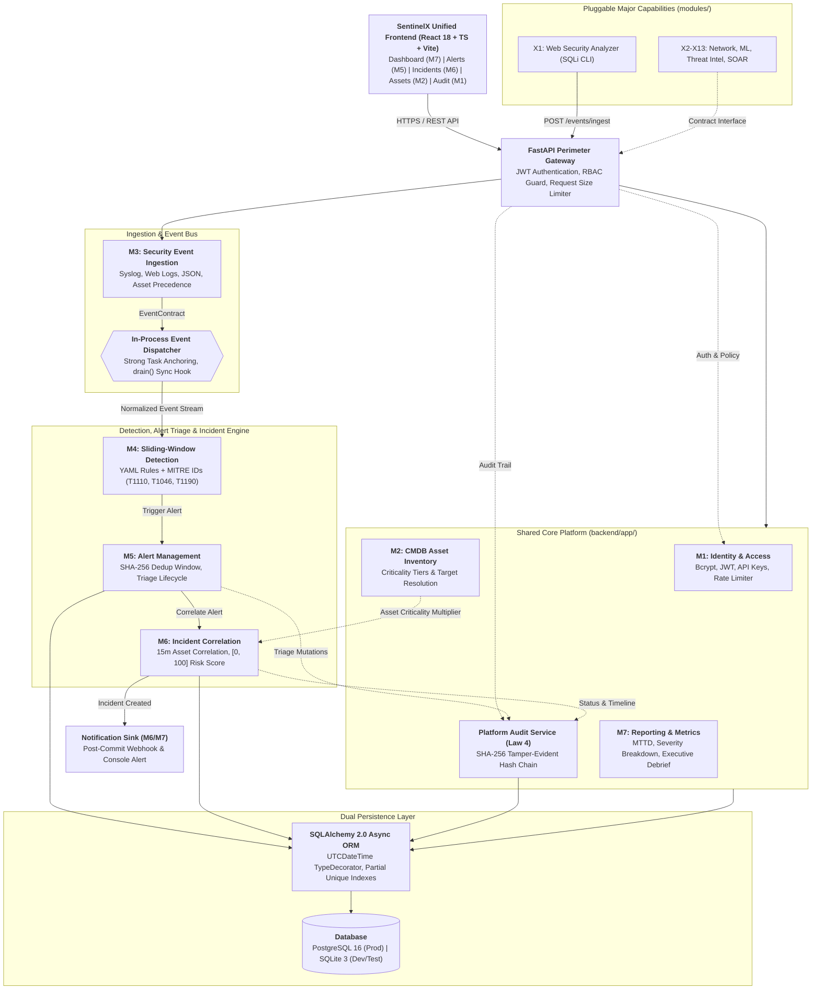

# SentinelX System Architecture Specification

## 1. Architectural Philosophy & Governing Laws

SentinelX is designed as a **Modular Monolith** for Phase 1 (Minor Scope) with strict contract-based plugin boundaries designed to transition seamlessly to distributed microservices in Phase 8 (Major Scope).

The codebase is governed by the Six Core Architectural Laws codified in `AGENTS.md`:
1. **Law 1: Strict Dependency Inversion & Module Boundaries**: Shared core platform (`backend/app/`, M1–M7) must **never** import from capability modules (`modules/`). Capability modules interact exclusively via immutable data contracts or REST APIs.
2. **Law 2: Immutable Contract Primacy**: Cross-module data transfers adhere to Draft-07 JSON Schemas (`contracts/`), Pydantic v2 twins (`contracts/python/models.py`), and TypeScript interfaces (`frontend/src/types/index.ts`).
3. **Law 3: Dual-Database Engine Compatibility**: Every query and model operates interchangeably on SQLite 3 (`aiosqlite`) and PostgreSQL 16 (`asyncpg`). Timestamps are normalized via custom `UTCDateTime` TypeDecorators. Time bounds are calculated in Python via `timedelta` bindings.
4. **Law 4: Tamper-Evident Hash Chaining**: All security mutations are written to a cryptographic SHA-256 hash chain with strict `asyncio.Lock` serialization.
5. **Law 5: Single-Worker Architecture (Minor Scope)**: Minor scope runs with `--workers 1` without multi-worker distributed lock managers or external broker clusters.
6. **Law 6: Standalone-First Verification**: Every capability and service is verified via unit tests, SQLite test harnesses, and offline benchmarks prior to containerized integration.

---

## 2. High-Level System Architecture

---

## 3. Data Flow & Transaction Boundaries

1. **Ingest Phase**: Client submits telemetry via `POST /api/v1/events/ingest`. If authenticated with an `ApiKey` bound to an `asset_id`, the bound asset strictly overrides payload claims. The event is persisted to the `events` table and committed.
2. **Post-Commit Dispatch**: After transaction commit, the event is serialized into an immutable `EventContract` and published to `EventDispatcher.dispatch()`. Subscribers execute in asynchronous background tasks tracked in a strong reference set.
3. **Sliding-Window Rule Evaluation**: `DetectionService` calculates temporal boundaries in Python (`window_start = event.event_time - timedelta(seconds=rule.window_seconds)`) and executes standard parameter-bound queries across the sliding window.
4. **Deterministic Alert Deduplication**: If a rule threshold is met, `AlertService` hashes `sha256(rule_id:asset:source_ip)`. If an active alert (`NEW` or `INVESTIGATING`) exists, its counter and evidence IDs (capped at 100) are updated with `with_for_update()`. Otherwise, a new alert is created.
5. **Asset-Centric Correlation & Closed-Form Risk Scoring**: `IncidentService` searches for open incidents on the same target asset updated within the last 15 minutes (900 seconds). Correlated incidents recalculate their closed-form risk score:
   $$\text{RawScore} = \left(\max_{a \in \text{alerts}} \text{BaseScore}(a.\text{severity})\right) \times \text{AssetMultiplier} + (|\text{alerts}| - 1) \times 15 + \min\left(20, \sum_{a \in \text{alerts}} (a.\text{occurrence\_count} - 1) \times 2\right)$$
   $$\text{RiskScore} = \min(100, \max(0, \text{round}(\text{RawScore})))$$
6. **Tamper-Evident Audit Logging**: State transitions across authentication, assets, alerts, and incidents are recorded sequentially through `AuditService.log_action()` protected by `asyncio.Lock()`.
